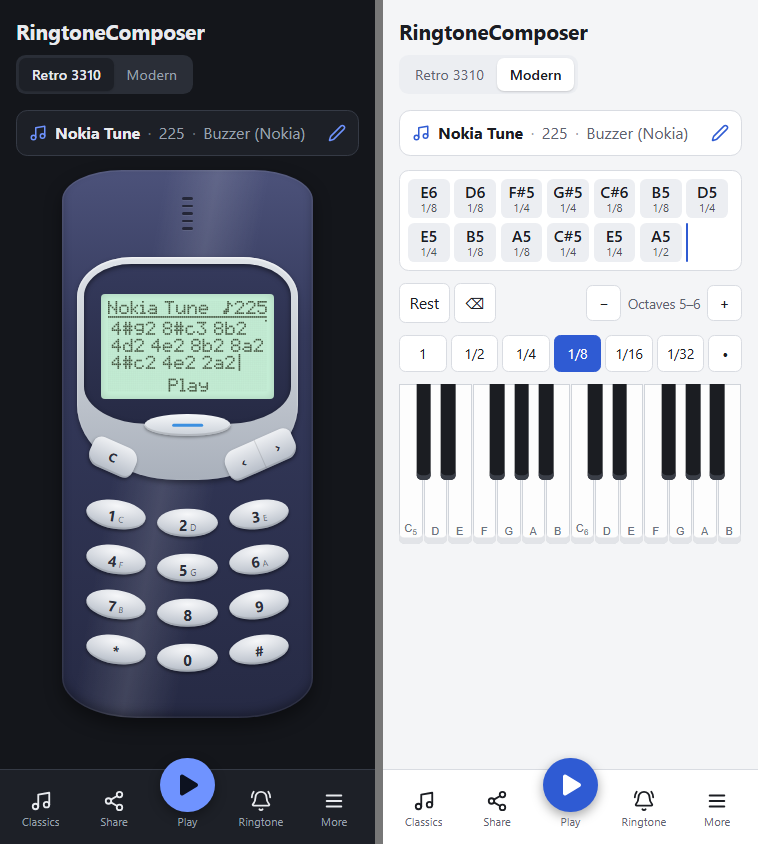

# RingtoneComposer 📟

[English](README.md) · **Français**

[](https://github.com/skacofonix/ringtone-composer/actions/workflows/ci.yml)
[](https://github.com/skacofonix/ringtone-composer/actions/workflows/pages.yml)
[](LICENSE)

Compose tes sonneries comme sur un Nokia 3310, directement depuis ton smartphone.

Une application web installable (PWA) pour composer, écouter, partager et exporter des sonneries au format **RTTTL**. Deux modes :

- **Rétro** : l'écran LCD et le clavier T9 du Nokia 3310, comme en 2000 ;
- **Moderne** : un clavier de piano, plus simple pour composer.

👉 **Essayer : <https://skacofonix.github.io/ringtone-composer/>** (installable sur l'écran d'accueil).



> 🚧 Projet en cours de (re)construction. Version précédente (C#, 2015) : <https://github.com/skacofonix/RingtoneComposer>

## Fonctionnalités

- Composition note par note, en mode rétro ou moderne
- Lecture avec un son « buzzer » authentique
- Import et export du texte RTTTL
- Catalogue de classiques du domaine public (Nokia Tune, Tetris, Lettre à Élise…)
- Partage par lien
- Choix de l'instrument : buzzer Nokia, console 8-bit, flûte, orgue, boîte à musique, piano électrique
- Export audio pour en faire sa sonnerie (Android et iPhone), et export MIDI
- Fonctionnement hors ligne
- Thèmes clair et sombre (suit le système par défaut)
- En français et en anglais (langue du navigateur par défaut, modifiable)

## Utiliser une sonnerie

Une application web ne peut pas changer la sonnerie du téléphone elle-même. L'application exporte un fichier WAV, puis :

- **Android** : Paramètres → Son → Sonnerie → choisir le fichier téléchargé ;
- **iPhone** : importer le fichier dans GarageBand, puis Partager → Sonnerie (guide pas à pas dans l'application).

## Développement

Prérequis : Node.js (version dans `.nvmrc`).

```bash
npm install
npm run dev        # http://localhost:5173
npm run verify     # format, lint, types, tests et build, comme la CI
```

Pour tester sur ton téléphone, lance `npm run dev -- --host` et ouvre l'adresse IP affichée depuis un appareil du même réseau Wi-Fi.

Stack : Vite, TypeScript et Svelte 5, sans backend. Voir [AGENTS.md](AGENTS.md) (en anglais) pour l'architecture et les conventions, et les spécifications [RTTTL](docs/rtttl.fr.md) et [Compositeur Nokia](docs/nokia-composer.fr.md).

## Licence

[MIT](LICENSE)
